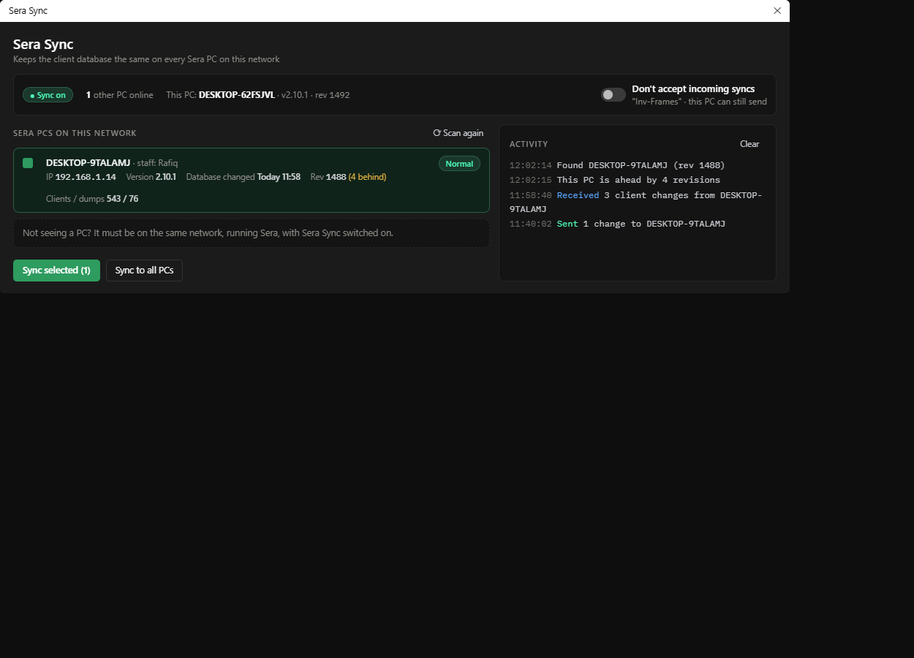

# Sera Sync

Mockup only — nothing in the app has changed yet.

## What's wrong today

- **A huge banner for one sentence** — The green status box takes a quarter of the window to say "LAN sync active".
- **The device table doesn't fit** — Eight columns squeezed into half the width: the headers are clipped ("erna", "stna") and it scrolls sideways. When empty, it's a blank white box with no explanation.
- **"Inv-Frames" is jargon** — A game term for a setting that stops this PC from accepting incoming syncs. You have to read the tooltip to learn what it does.
- **Three button colours** — Green, blue and dark buttons, with no clear primary action.

## What changes

- A one-line status strip replaces the banner: sync state, how many PCs are online, and this PC's name, version and revision.
- Inv-Frames becomes a plain switch named for what it does ("Don't accept incoming syncs"), with the old name underneath so it's still recognisable. The tooltip still explains the multi-PC freeze rule.
- Devices become cards, so all eight facts fit without sideways scrolling. The revision score also says whether that PC is ahead or behind. With no devices, the list explains what's needed.
- One primary button (Sync selected, with a count); Sync to all is secondary.

## Kept as it is

- Every column (username, hostname, IP, version, DB modified, rev score, clients/dumps, mode/status), Refresh, Clear and the live activity stream.

## Where every current control goes

| Today | Redesign |
|---|---|
| "N devices online" | Status strip |
| LAN SYNC ACTIVE banner | "Sync on" pill in the status strip |
| Inv-Frames: ON/OFF button | Switch in the status strip, same tooltip |
| 8-column device table | Device cards (all 8 facts), tick to select |
| Sync Selected / Sync To All / Refresh | Primary / secondary buttons; Refresh → "Scan again" |
| Live Sync Activity Stream + Clear | Activity card on the right |
| Close | The window's ✕ |

## Addendum: feature map of the built dialog (S-12, 2026-10-11)

Every control of `ui/dialogs/sera_sync_dialog.py` and where it went. Nothing was dropped; attribute
names, handlers, setting keys and confirmations are unchanged.

| Control (attribute) | Built place |
|---|---|
| Title, ✕ | `DialogFrame` header "Sera Sync" + Close (Esc) icon button; Esc / ✕ close the dialog |
| "N devices online" (`status_label`) | Status strip, after the Sync on / off pill (`sync_pill`); then This PC name, version, Mode pill (`mode_pill`, office mode) |
| Public-network warning (`network_warning_banner`) | Amber `Banner` above the strip |
| Discovered LAN devices table (`table`, 7 columns, right-click menu) | Devices tab, `DarkListTable` in a card; status is a pill; every fact also in the row tooltip; narrow windows hide DB Modified, Version, Clients / Dumps (in that order); right-click menu unchanged |
| Empty device list | `EmptyState` (`devices_empty`) with its own Add PC by IP (`btn_empty_add_ip`, same handler) + info banner "Not seeing a PC?" |
| Refresh (`btn_refresh`) | Devices tab, relabelled **Scan again** |
| Add PC by IP, Remove PC by IP, Rejoin office, Export recovery kit (`btn_add_ip`, `btn_remove_ip`, `btn_rejoin`, `btn_export_kit`) | Devices tab button row; Rejoin only in legacy mode, the kit only in office mode, as before |
| Office Members table (`members_table`), members warning (`members_network_warning`) | Office members tab (office mode only): red `Banner`, card with the table (Online and This PC as pills) |
| Add workstation, Remove, Hand over admin, Become admin | Office members tab; **Add workstation** is the dialog's one primary; off states say why |
| Sync Status summary, parked warning (`sync_status_summary_label`, `sync_status_warning_label`) | Sync status tab, "Sync status" card; the warning is a `Banner` (amber > 1 h in shadow, red > 7 days) |
| Shadow mode label, Start / Reset shadow mode, Go live, Run now, shadow checks label | Sync status tab, "Shadow mode" card (Go live soft); PIN confirmation unchanged |
| Conflicts table, Keep, Use discarded value | Sync status tab, "Conflicts" card |
| Live Sync Activity Stream (`log_list`) + Clear | "Live activity" card on the right: kit `LogView`, 400 lines kept, category as a coloured tag |
| Close (`btn_close`) | Dialog footer |
| Add workstation code window, Add / Remove PC by IP prompts, Become admin password, every confirmation | Unchanged Qt message boxes / input dialogs |

Not built because the control does not exist in today's code: **Sync selected / Sync to all** (removed
in P4-1, a test keeps them absent), the **Inv-Frames** switch (no such control or setting in the dialog;
only an `INV_FRAMES` activity category, which keeps its amber tag), the per-device **tick** (only
needed for Sync selected) and **ahead / behind** (the peer data carries no revision score; adding one
is a sync-protocol change). Office mode opens on the Sync status tab (the old dialog put the office
panels first); legacy mode shows the Devices content only, without the tab switch.
