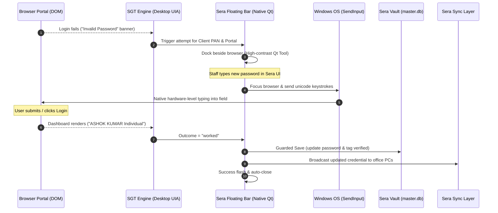
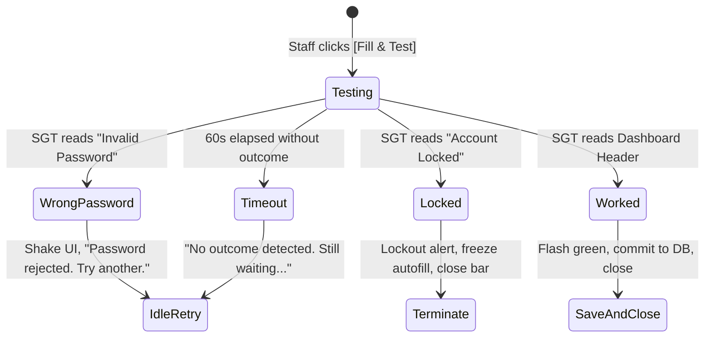

# Blueprint: Model B — Desktop Floating "Test & Fill" Bar

## 1. Executive Summary & Objective

**Goal:** Detect a password login failure on registered government portals (Income Tax, GST, TRACES) completely at the desktop level, allow office staff to provide/test a new working password through a native desktop interface, deliver the credential to the portal via genuine OS keystrokes (zero DOM/extension involvement), verify the login outcome passively via Windows UI Automation (SGT), and update the encrypted client vault in `master.db`.



---

## 2. Core Constraints & Guarantees

1. **Zero Browser Infiltration (ToS & Anti-Bot Compliance):**
   - No content scripts reading, hooking, or mutating password fields.
   - The browser runs completely standard/vanilla.
   - Anti-bot systems (Akamai, Cloudflare, portal integrity checks) see zero DOM script manipulation.
2. **Hardware-Equivalence via OS Keystrokes:**
   - Password entry is executed via Windows `SendInput` (`KEYEVENTF_UNICODE`).
   - Generates genuine `WM_KEYDOWN`, `WM_CHAR`, `WM_KEYUP` operating system messages.
   - Input events in Chromium report `isTrusted: true`, identical to typing on a physical keyboard.
3. **Passive UIA Sensing:**
   - SGT reads accessibility nodes via `UIAutomationCore.dll` outside the browser process.
   - SGT does not query `IsPassword=True` elements (preserving OS security boundaries).
4. **Zero Plaintext Logging:**
   - Candidate password exists only in volatile process memory during the active attempt.
   - Audit logs store metadata (`client_id`, `portal`, timestamp, actor, outcome) and **never** the password string.

---

## 3. End-to-End Workflow & Architecture

### Phase 1: Passive Failure Detection (SGT-C Engine)

SGT already continuously inspects the top-level Chromium window (`hwnd`):
1. **Context Identification:** SGT matches the portal URL/Title and extracts the active Client PAN (e.g. from `itr_pan` spec or active session).
2. **Failure Recognition:** Evaluates text lines against `core/scc/scc_rules.json`:
   - Income Tax: Matches `itr_wrong_password` (`"Invalid Password"`, `"Incorrect password"`, `"Please enter a valid password"`).
   - GST: Matches `gst_wrong_password` (`"Invalid Username or Password"`).
   - *Exclusion Check:* Must not trigger on `"Invalid Captcha"` or `"Enter valid captcha"`.
3. **State Activation:** If failure matches a registered client whose portal password failed:
   - SGT emits `login_failure_detected(client_id, pan, portal, hwnd)`.
   - Freezes automatic autofill for this client (`suppress_client`) to prevent other windows from burning attempts.

---

### Phase 2: The Floating "Test & Fill" Bar (Native Qt UI)

A lightweight, frameless, high-contrast desktop widget pops up adjacent to the portal window.

#### UI Mockup & Design
```
┌────────────────────────────────────────────────────────────────────────┐
│ [mdi:shield-key] Income Tax • ABCPD1234E (Ashok Kumar)          [mdi:close] │
├────────────────────────────────────────────────────────────────────────┤
│ New Password: [ •••••••••••••••••• ] [mdi:eye]  [ Fill & Test ]        │
│ ℹ Status: Ready — Enter the working password to test and save           │
└────────────────────────────────────────────────────────────────────────┘
```

#### Specifications:
* **Window Attributes:** `Qt.WindowStaysOnTopHint | Qt.FramelessWindowHint | Qt.Tool` (doesn't create a taskbar button; doesn't steal focus when shown).
* **Styling:**
  - Background: `#171717` (Sera dark surface) with subtle `#FF4D4D` accent border on failure.
  - Typography: Pure white text `#FFFFFF`, monospace font for password field.
  - Icons: Strictly Google Material Design (`mdi.shield-key`, `mdi.eye`, `mdi.eye-off`, `mdi.keyboard-outline`, `mdi.check-bold`, `mdi.close`).
* **Positioning Logic:**
  - Obtains browser bounding rect via `win32gui.GetWindowRect(hwnd)`.
  - Docks smoothly to the **top-right inside edge** or **immediately adjacent right/top** of the browser window.
  - Follows browser window movements if moved/resized.
* **Auto-TTL:**
  - Auto-closes if left unattended for 3 minutes without user activity.

---

### Phase 3: Native OS Input Injection (`Win32 SendInput`)

When staff clicks **[ Fill & Test ]** (or presses `Enter` inside the password box):

1. **Targeting the Browser:**
   - Store the candidate password in volatile memory: `self._candidate = pwd_input.text()`.
   - Call Win32 `SetForegroundWindow(browser_hwnd)` to restore focus to the browser.
2. **Targeting the Password Field:**
   - In 95% of portal failure states (ITR & GST), after an invalid password error, the browser's DOM automatically refocuses the password input, or the user already has the cursor in the field.
   - Sera verifies the focused control, or allows a 250ms settling time.
3. **Hardware-Level Typing Simulation:**
   - Uses `SendInput` with `KEYEVENTF_UNICODE`.
   - Sends characters sequentially with a natural micro-delay (12–20 ms per character). This ensures browser JS input listeners process each keystroke correctly without dropped buffer characters.
   - Optional: Clear existing content first (`Ctrl+A` &rarr; `Backspace`) before typing new characters.
4. **Form Submission:**
   - Two selectable modes:
     - **Type Only (Default for GST/TRACES):** Types the password so staff can solve the CAPTCHA and click Login manually.
     - **Type & Submit (For Income Tax):** Types the password and synthesizes an `Enter` key event or leaves it for the user to click "Login".

---

### Phase 4: SGT Outcome Verification Loop

While the bar displays **"Testing credentials on portal..."**:



1. **Outcome = `wrong_password`:**
   - Bar shakes (CSS subtle animation), input turns amber/red:  
     *"Portal rejected this password. Please check and try another."*
   - Candidate is discarded from memory.
2. **Outcome = `locked`:**
   - Bar switches to warning mode:  
     *"Account has reached maximum attempts and is locked. Ceasing attempts."*
   - Bar closes and permanently flags client in Sera as `needs_admin_unlock`.
3. **Outcome = `worked`:**
   - SGT reads the post-login profile header (e.g. `"<NAME> Individual"` in `itr_logged_in_header` or `/dashboard` URL).
   - Status updates with a bold green banner:  
     **[mdi:check-bold] Login Succeeded! Password saved to Sera Vault.**

---

### Phase 5: Guarded Vault Mutation & Synchronization

Upon `worked` outcome confirmation, Sera executes the guarded save (integrating with `core/scc/save.py`):

1. **Database Update (`master.db`):**
   - Retrieves the client's configured password column ID (`_password_column`).
   - Updates the value with the verified candidate.
   - Appends `"Password verified via Desktop Bar"` to client notes.
2. **Audit Trail (`audit_log`):**
   - Writes an immutable audit entry:
     - `action`: `PORTAL_PASSWORD_ROTATED`
     - `client_id`: `CLI-00123`
     - `portal`: `Income Tax`
     - `method`: `Desktop Test & Fill Bar`
     - `actor`: Current workstation / staff username
     - *Password text is explicitly excluded from the audit log.*
3. **Sera Sync Broadcast:**
   - Emits `scc_saved_signal` to notify other workstations via `sync_manager` so no other computer uses the obsolete password.
4. **Release Autofill:**
   - Clears `suppress_client` so normal fast autofill and clipboard assist resume with the new working password.
5. **Dismissal:**
   - Bar displays the green success state for 2.5 seconds, then gracefully fades out and destroys itself.

---

## 4. Key Edge Cases & Guardrails

| Edge Case | Problem | Solution |
| :--- | :--- | :--- |
| **CAPTCHA Requirements (GST / TRACES)** | User cannot auto-login with Enter because CAPTCHA must be typed. | The Bar only fills the password field; staff types CAPTCHA and clicks Login. SGT waits for the dashboard transition. |
| **Captcha Mistake vs Password Mistake** | Staff mistypes CAPTCHA on GST. | SGT rule checks `patterns`: `"Invalid Captcha"` is explicitly marked `neutral` and will **not** trigger failure or reject the password. |
| **Multi-Step Logins (Income Tax 2.0)** | PAN is step 1; Password + Checkbox is step 2. | SGT's `itr_pan` detects failure specifically on `#/login/password`. Bar only triggers when the password page is active. |
| **Accidental Dismissal** | Staff accidentally clicks outside. | Bar is a persistent tool window while the browser is focused. Does not close on blur unless `[mdi:close]` is clicked or 3-minute TTL expires. |
| **Multiple Browser Tabs/Windows** | Two staff or two windows open simultaneously. | Every Bar instance is bound strictly to a specific Win32 `hwnd` and `AttemptId`. Actions in Window A cannot touch Window B. |
| **Autofill Race Condition** | Other PCs autofilling stale passwords. | `suppress_client` freezes SCA immediately on failure. Autofill stays frozen until rotation completes and sync finishes. |
| **Stranded Password Intent** | System crashes before DB commit. | Candidate intent is held with session metadata. Recovery loop on app startup can detect unconfirmed attempts. |

---

## 5. Complementary Extension: The "Minting" Password Reset Flow

For scenarios where staff is performing a **Password Reset** on the portal (rather than entering an existing client-changed password):

1. **Sera-Authored Password Minting:**
   - Sera generates a cryptographically secure password (e.g. `secrets.token_urlsafe(12)` conforming to portal complexity rules).
   - The Desktop Bar offers a 1-click **[ Generate & Fill ]** button on the portal's "Reset Password" screen.
   - Because Sera generated the string, the vault value is known in advance.
2. **Stranded State Prevention:**
   - Write the intent (`pending_password = ...`) before submitting the change to the portal.
   - If the portal confirms password reset and staff completes the initial login, the pending status promotes to `verified`.

---

## 6. Proposed File Architecture

```
core/
└── rotation/
    ├── __init__.py
    ├── detector.py          # Bridges SGT UIA failure events to rotation triggers
    ├── injector.py          # Win32 SendInput unicode keystroke engine
    └── session.py           # Attempt lifecycle, TTL, candidate state in RAM

ui/
└── components/
    └── test_fill_bar.py     # Native PySide6 frameless floating tool window
```
